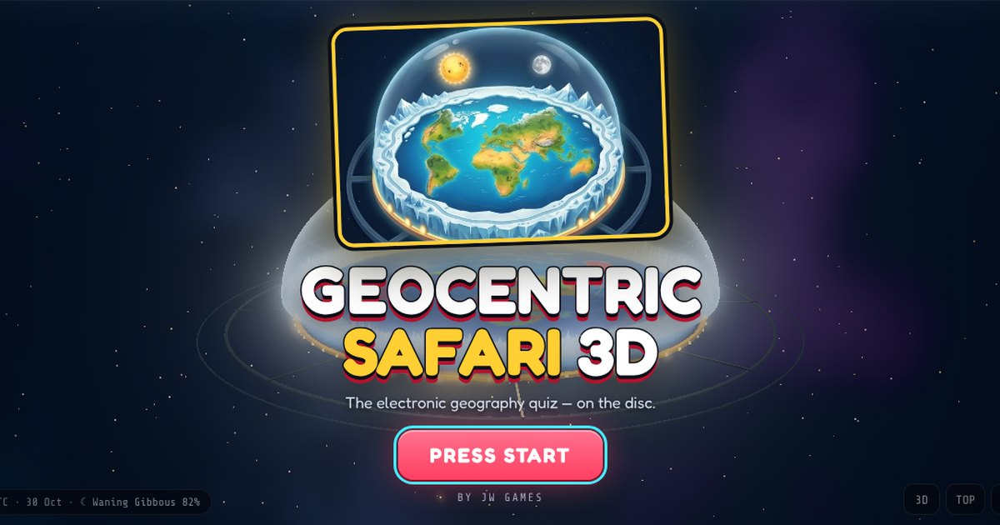

# Geocentric Safari 3D

**The electronic geography quiz — on the disc.** A tribute to the classic 90's GeoSafari quiz console, played on a flat earth (azimuthal-equidistant) map under a glass firmament dome.

Live: https://geocentric-safari-3d.netlify.app



## What's in the box

- **Lesson cards, GeoSafari style.** 7 cards × 20 numbered spots: Nations of the Disc, Capital Cities, Wonders & Landmarks, Peaks & Volcanoes, Oceans/Seas & Lakes, Islands & Territories, Explorer's Extremes. Every spot has a clue and a "did you know?" fact.
- **The console.** 20 question lamps around the board, red seven-segment score displays, an amber countdown timer, a green entry readout and a chunky rubber keypad. Answer by typing the spot number and pressing **GO**, or tap the spot.
- **Three tries, beat the clock.** First-try answers score 100, then 60, then 30, plus 5 points per second left and a streak bonus. After a miss the right spot flashes so everyone learns it.
- **Two-player mode.** Players alternate, each with their own score display and turn light.
- **Map Hunt mode.** No numbers — tap the place itself. Misses tell you how far off you were and which way to head.
- **A living sky.** The sun, moon (with its real phase) and constellations hang over the places where they are overhead *right now*, computed from a low-precision ephemeris. Daylight sweeps across the disc; speed the sky clock up in Settings.
- **The model.** North Pole at the centre, the prime meridian pointing down (the UN-emblem layout), the Antarctic ice rim as a wall of ice, a gold base ring with lights, and the glass firmament dome over it all.
- **Zoom right in.** Scroll, pinch or use ＋/－ up to 64×. As you zoom in the view flattens to straight-down and the map is redrawn sharply from the detailed (1:50m) data, so even Luxembourg or Malta fill the screen.
- **Free Explore.** Hover or tap anywhere to identify countries with their coordinates, local solar time and sun altitude.
- **Polish.** Synthesised console sounds, optional talking console (reads questions aloud), country-name labels, natural-colour or lesson-card map styles, keyboard shortcuts and high scores per card.

## Graphics modes

- **Simple (default)** — no WebGL at all, so it runs on any computer. The map is a pre-rendered picture tilted with CSS; the ice wall, gold ring, dome, stars, sun and moon are a few SVG shapes and DOM elements redrawn only when the view or sky changes. Idle CPU use is a few percent.
- **Full 3D** (Settings → Graphics) — the three.js scene with lighting and ice shards. It renders on demand, lowers its resolution if frames run late, and drops to a Lite mode if the browser has no graphics acceleration.

Append `?gfx=simple`, `?gfx=low`, `?gfx=high` or `?gfx=lite` to the URL to force a mode for testing.

## Controls

| Action | Mouse / touch | Keyboard |
| --- | --- | --- |
| Turn & tilt / zoom / pan | Drag · scroll, pinch or ＋/－ · right-drag, shift-drag or two fingers (drag pans once zoomed in) | `+` / `-` zoom |
| Turn the disc | ⟲ ⟳ buttons | `A` / `D` |
| Top-down card view / 3D view | TOP / 3D | `T` / `V` |
| Enter a spot number | Keypad | `0`–`9`, `Enter` = GO, `Backspace` = CLR |
| Hint (half points) | HINT | `H` |
| Country names | 🏷️ | `L` |
| Pause / menu | MENU | `Esc` |

## Project layout

```
public/            ← the whole site (Netlify publishes this folder)
  index.html
  css/style.css
  js/              ← app.js (game), flatworld.js (Simple mode), world.js (Full 3D, three.js),
                     mapPainter.js (D3 map drawing), spots.js (numbered spots), cards.js (lesson cards),
                     astro.js (sun/moon/stars), geo.js (map data + disc maths), sevenseg.js, audio.js, main.js
  assets/          ← pre-rendered disc maps (map-*.webp), cover art, icons
  data/            ← Natural Earth countries (world-atlas 110m for start-up, 50m for close-ups and 3D)
  vendor/          ← three.js, d3-geo, topojson, fonts — copied from npm, no CDN needed
  sw.js            ← retires the offline cache used by earlier releases
scripts/           ← vendor.mjs, bake-maps.cjs, serve.mjs
netlify.toml       ← publish dir, security headers (CSP), caching
```

## Develop

```bash
npm install
npm run vendor  # copy three.js, d3, topojson, fonts and map data into public/
npm start       # http://localhost:8080
npm run bake    # (with npm start running) re-render public/assets/map-*.webp after changing mapPainter.js
```

`npm run bake` needs Playwright with Chromium (`npx playwright install chromium`).

## Deploy to Netlify

The Netlify project **geocentric-safari-3d** is already set up. Pick one:

- **Connected repo (current setup):** every push to the linked branch deploys automatically. `netlify.toml` sets the publish folder (`public`) and no build command.
- **One-off deploy from your machine:**
  ```bash
  npx netlify-cli deploy --prod --dir=public --site=geocentric-safari-3d
  ```

## Credits

Map data © [Natural Earth](https://www.naturalearthdata.com/) via [world-atlas](https://github.com/topojson/world-atlas). Built with [d3-geo](https://github.com/d3/d3-geo), [topojson](https://github.com/topojson/topojson-client) and, for Full 3D, [three.js](https://threejs.org/). Fonts: Fredoka, VT323, Share Tech Mono (SIL OFL). GeoSafari is a trademark of Educational Insights; this is an unaffiliated fan tribute by JW Games.
